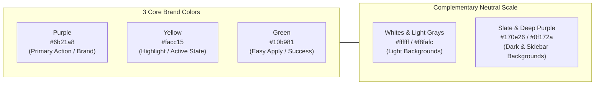

# DuckDuckWork Design System

This document defines the official design system, color palette, typography, and visual consistency rules for **DuckDuckWork**.

---

## 1. Fundamental Color Rule

To maintain visual consistency and avoid visual clutter, the interface uses **exactly 3 core brand chromatic colors**, accompanied by a **complementary neutral scale** (whites, grays, and slate tones) across both **Light Mode** and **Dark Mode**.

---

## 2. Core Brand Color Palette

### 2.1. Purple (Primary Brand Color)
- **Hex**: `#6b21a8` (`var(--primary)`)
- **Hover**: `#581c87` (`var(--primary-hover)`)
- **Light Background**: `#f3e8ff` (`var(--primary-light)`)
- **Standard Usage**:
  - Primary application button **"Apply Now →"** (for standard job sources).
  - Active search profile tabs.
  - Section headers, focus rings, and primary brand identity elements.

### 2.2. Yellow (Highlight & Active State)
- **Hex**: `#facc15` (`var(--accent-yellow)`)
- **Hover**: `#eab308`
- **Light Background**: `#fef9c3`
- **Standard Usage**:
  - Active navigation item in left sidebar (*Sidebar nav active*).
  - Salary highlights and alert badges.
  - Saved / favorite status indicator.

### 2.3. Green (Fast Action & Success)
- **Hex**: `#10b981` (`var(--accent-green)`)
- **Hover**: `#059669`
- **Light Background**: `#dcfce7`
- **Standard Usage**:
  - Exclusive **"Easy Apply →"** action button (LinkedIn Easy Apply roles).
  - High match rating badge (*High Fit Score ≥ 85%*).
  - "Applied" job pipeline status.

---

## 3. Complementary Neutral Scale (Light & Dark Mode)

| Element | Light Mode | Dark Mode |
| :--- | :--- | :--- |
| **Application Background** | `#f6f3fb` (Ultra-light lavender neutral) | `#130b20` (Midnight purple slate) |
| **Cards & Modals Background** | `#ffffff` (Pure white) | `#1d122f` (Elevated dark slate) |
| **Sidebar Navigation** | `#241244` (Deep dark purple) | `#170e26` (Night purple) |
| **Primary Text** | `#0f172a` (Dark slate gray) | `#f8fafc` (Soft white) |
| **Secondary Text** | `#334155` (Medium slate) | `#d8b4fe` (Light lavender) |
| **Muted Text** | `#64748b` (Neutral slate gray) | `#a78bfa` (Muted purple) |
| **Borders & Separators** | `#e9d5ff` / `#e2e8f0` | `#2e1c4a` / `#24163b` |

---

## 4. Typography & Hierarchy

- **Primary Interface Font**: `'Plus Jakarta Sans'`, sans-serif (weights: 500, 600, 700, 800).
- **Data & Code Font**: `'JetBrains Mono'`, monospace (weights: 600, 700) for fit scores, salaries, dates, and session IDs.

---

## 5. Component Specifications

### 5.1. Action Buttons
1. **"Apply Now →" (Default)**:
   - **Color**: Brand Purple (`#6b21a8`).
   - **Applies to**: Get on Board, Remotive, Indeed, external LinkedIn, and all standard sources.
2. **"Easy Apply →" (Exclusive)**:
   - **Color**: Action Green (`#10b981`).
   - **Applies to**: LinkedIn Easy Apply roles only.

### 5.2. Job Cards
- White elevated cards with soft borders (`var(--border-light)`).
- Hover elevation (`transform: translateY(-2px)`).
- Company name in uppercase muted styling with 40x40px rounded logos.

### 5.3. Filter & Navigation System
- **Active Tab**: Purple background (`#6b21a8`) with white text.
- **Active Sidebar Navigation**: Yellow background (`#facc15`) with dark slate text (`#0f172a`) for maximum contrast.

---

## 6. Admin Control Panel (`/admin`) Brand Alignment

The Admin Control Panel adheres to the exact same DuckDuckWork core brand system and midnight purple dark theme:

- **Background (`--bg-main`)**: `#0f0c1b` (Midnight purple slate).
- **Header & Navigation Bar (`--bg-header`)**: `#170e26` (Night purple slate).
- **Cards & Modals (`--bg-card`)**: `#1d122f` (Elevated dark purple slate).
- **Card Hover / Row Hover (`--bg-card-hover`)**: `#2d1a4d`.
- **Borders & Table Dividers (`--border-color`)**: `#2e1c4a`.
- **Primary Text (`--text-main`)**: `#f8fafc` (Soft white).
- **Muted Text (`--text-muted`)**: `#a78bfa` (Muted purple).
- **Brand Accents**:
  - Primary Purple: `#9333ea` / `#6b21a8` (`--accent-purple`).
  - Highlight Yellow: `#facc15` (`--accent-yellow`) for badges and primary metrics.
  - Action Green: `#10b981` (`--accent-green`) for online statuses and success indicators.
  - Danger Red: `#ef4444` (`--accent-red`) for purge/delete actions.
- **Date Display Format**: All session timestamps (`created_at`, `last_active`) display in the candidate's local timezone formatted as `YYYY-MM-DD h:mm AM/PM` (e.g. `2026-10-03 7:00 PM`).

