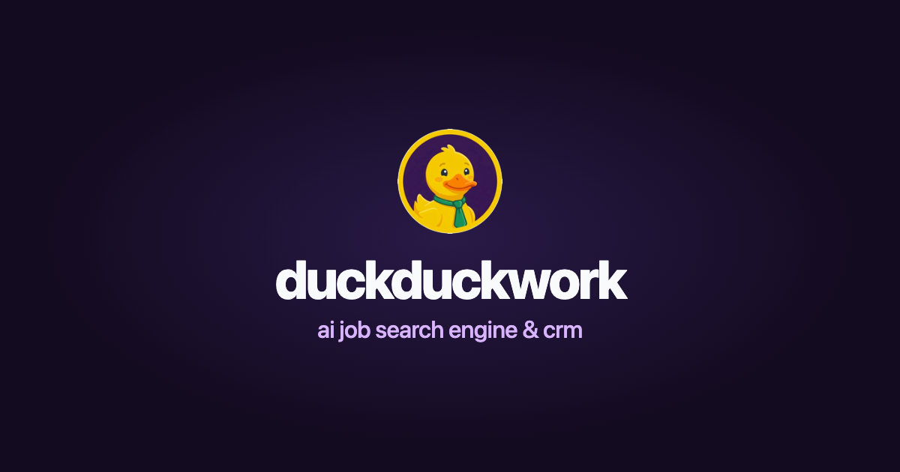
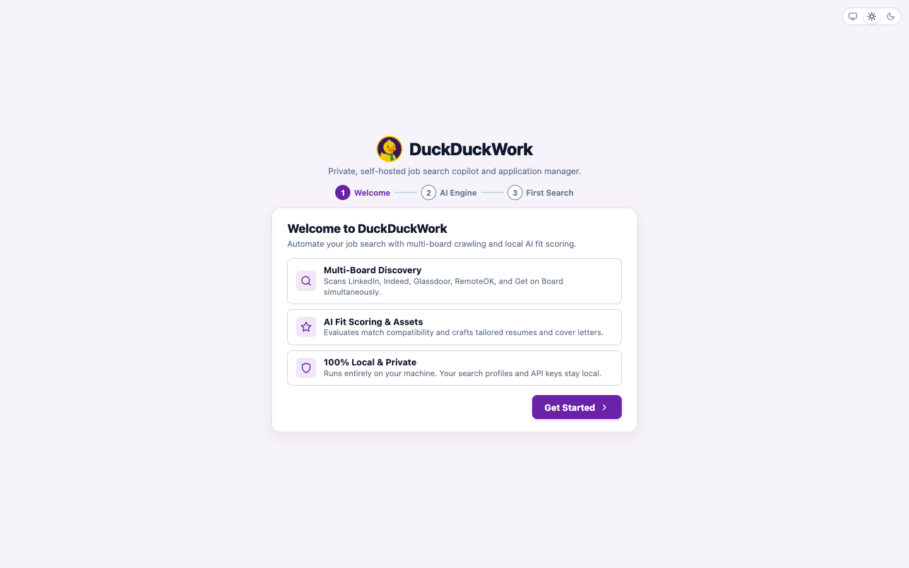
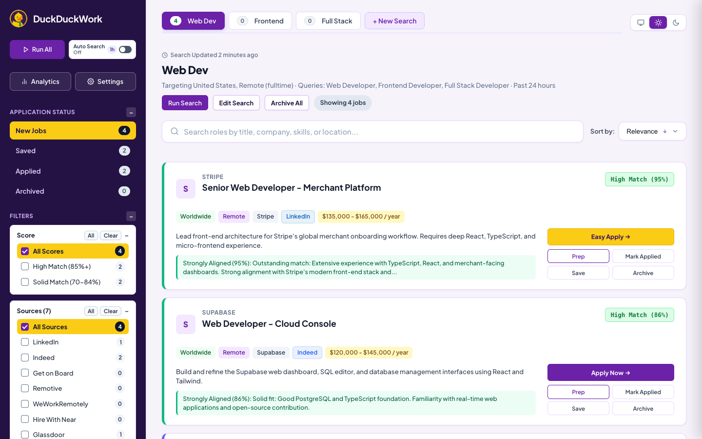
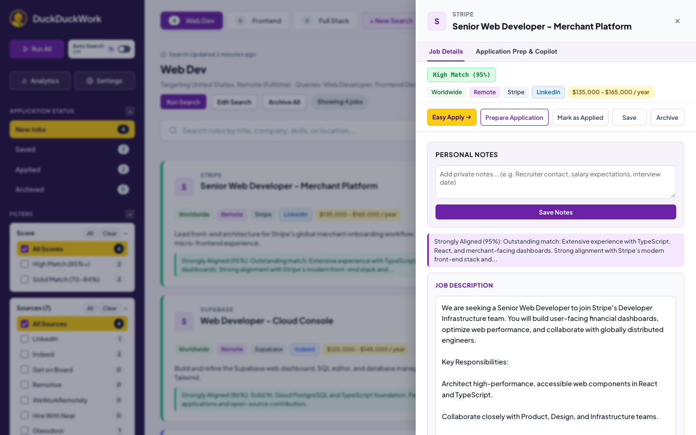
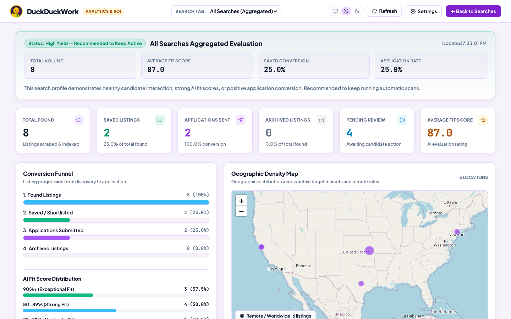

<div align="center">
  <a href="https://ddw.crda.dev">
    
  </a>
</div>

# duckduckwork — autonomous ai job search engine & career crm

high-performance, local-first job discovery engine, candidate-job fit evaluation system, ats resume tailor, and interactive career crm web dashboard.

[](https://ddw.crda.dev)
[](LICENSE)
[](https://www.python.org/)
[](https://ai.google.dev/)

---

## overview

duckduckwork is a private, self-hosted job search aggregator and candidate crm. it continuously scours major job boards (linkedin, indeed, glassdoor, ziprecruiter) and direct ats apis (greenhouse, ashby, lever), scores vacancies against your master resume using modern llms, and lets you manage applications from a clean, responsive web interface.

all candidate data, searches, resumes, and notes reside 100% locally on your machine in sqlite.

---

## screenshots

| **3-step onboarding wizard** | **job discovery & candidate crm** |
|:---:|:---:|
| [](docs/images/onboarding.png) | [](docs/images/dashboard.png) |
| guided setup to configure search queries, target locations, and optional ai scoring credentials. | multi-board aggregation with independent search tabs, live lead scoring, and status tracking. |
| **job copilot & fit evaluation** | **search tab roi & funnel analytics** |
| [](docs/images/drawer.png) | [](docs/images/analytics.png) |
| deep vacancy analysis, ai match reasoning, requirements audit, and fast application prep. | conversion funnels, board distribution, score breakdown, and interactive geospatial density map. |

---

## key features

- **multi-portal job discovery**: scrapes linkedin, indeed, glassdoor, and ziprecruiter, alongside direct public board integrations for greenhouse, ashby, and lever.
- **independent search profiles**: manage separate searches simultaneously (e.g., product manager, scrum master, staff engineer) with custom location and recency parameters.
- **ai-powered match scoring & two-line summaries**: evaluates candidate-job fit (0-100%) and generates concise role summaries without recruiter marketing fluff. works out of the box with google gemini, openai, openrouter, groq, or local ollama models.
- **works without ai (optional skip)**: an ai api key is completely optional. you can skip ai configuration during setup to use duckduckwork purely as a high-speed job aggregator and tracking portal.
- **proactive in-app notifications**:
  - missing api key alert: displays a discrete notification when no key is set, explaining that scraping runs normally while scoring requires a key, complete with a 24-hour reminder option.
  - in-app version update checker: checks github releases in the background and provides a 1-click "update now" button directly in the ui.
- **interactive career crm & copilot drawer**: track jobs across stages (new, saved, applied, archived), take private notes, and use 1-click clipboard helpers for quick applications.
- **analytics & search tab roi evaluator**: real-time pipeline funnels, top company and recruiter portal distributions, interactive openstreetmap geospatial density, and algorithmic advice on whether to keep or discard search profiles.
- **cross-device push alerts (telegram & whatsapp)**: get instant mobile notifications when automated background searches find matching opportunities, complete with local wi-fi and remote tunnel access links.

---

## architecture & underlying engine

duckduckwork is the public portal and candidate crm interface. under the hood, it is powered by **applypilot** (`src/applypilot`), an internal discovery and matching engine:
- **discovery pipeline**: multi-source scraping and ingestion via jobspy (linkedin, indeed, glassdoor, ziprecruiter) and direct public board rest api connectors (greenhouse, ashby, lever).
- **evaluation & match engine**: unified multi-provider llm client (google gemini, openai, groq, ollama) evaluating candidate-job fit without recruiter marketing fluff.
- **local sqlite storage**: zero-latency relational database with write-ahead logging (wal) ensuring 100% data ownership and privacy.
- **lightweight web engine**: built-in python server powering the responsive dashboard, analytics, and instant 1-click updates.

---

## quick installation

### prerequisites
- python 3.11 or higher (python 3.12 recommended).
- git.

### 1. clone repository & setup environment
```bash
# clone the repository
git clone https://github.com/jorgecerda/duckduckwork.git
cd duckduckwork

# create and activate virtual environment
python3 -m venv .venv
source .venv/bin/activate

# install duckduckwork in editable mode
pip install -e .
```

### 2. start duckduckwork
```bash
# start local server and open your browser automatically
duckduckwork serve --port 5050 --open

# note: 'ddw' and 'applypilot' can also be used as short aliases
```

### 3. complete first-time onboarding
on first launch, duckduckwork opens the automated 3-step onboarding wizard at `http://localhost:5050`:
1. **welcome**: quick platform overview.
2. **ai engine configuration (optional)**: connect your google gemini, openai, openrouter, or groq api key, or click **skip for now**.
3. **first search query**: enter your target role title, location, and enabled job portals, then click **launch duckduckwork**.

---

## ai provider configuration

duckduckwork supports multiple ai providers. you can configure them in the web settings (`http://localhost:5050/admin#db`) or in your `.env` file:

### google gemini (recommended)
generous free tier with fast response times:
```env
GEMINI_API_KEY=your_gemini_api_key_here
LLM_MODEL=gemini-2.0-flash
```

### openai
```env
OPENAI_API_KEY=sk-proj-...
LLM_MODEL=gpt-4o-mini
```

### ollama (local & 100% offline)
```env
LLM_URL=http://localhost:11434/v1
LLM_MODEL=llama3.2
```

### groq / openrouter
```env
LLM_URL=https://api.groq.com/openai/v1
LLM_API_KEY=gsk_...
LLM_MODEL=llama-3.3-70b-versatile
```

---

## in-app updating & git synchronization

duckduckwork can update itself with a single click:
1. when a new version is released on github, an **update available** banner appears at the top of your dashboard.
2. click **update now** to pull the latest changes via git and automatically reload your dashboard.
3. alternatively, update from your terminal at any time:
   ```bash
   git pull origin main
   pip install -e .
   ```

because all databases, session files, candidate profiles, and custom searches are stored in the local `.data/` directory (ignored by git), updating never modifies or deletes your personal job search data.

---

## telegram notifications setup (optional)

receive instant mobile notifications whenever background searches find new roles:
1. in telegram, message `@BotFather` and send `/newbot` to create a bot and copy your `bot token`.
2. open duckduckwork settings (`http://localhost:5050/admin#db`), paste your `bot token`, and toggle telegram on.
3. send `/start` to your new bot in telegram, click **detect id** in duckduckwork, and test with **send test alert**.

---

## license

distributed under the **mit license**. see [LICENSE](LICENSE) for more information.

---

## trademark and non-affiliation disclaimer

**duckduckwork** is an independent open-source project and is **not** affiliated, associated, authorized, endorsed by, or in any way officially connected with **duckduckgo, inc.** or any of its subsidiaries or affiliates. the official duckduckgo website can be found at [https://duckduckgo.com](https://duckduckgo.com).

the name "duckduckgo" as well as related names, marks, emblems, and images are registered trademarks of duckduckgo, inc.
